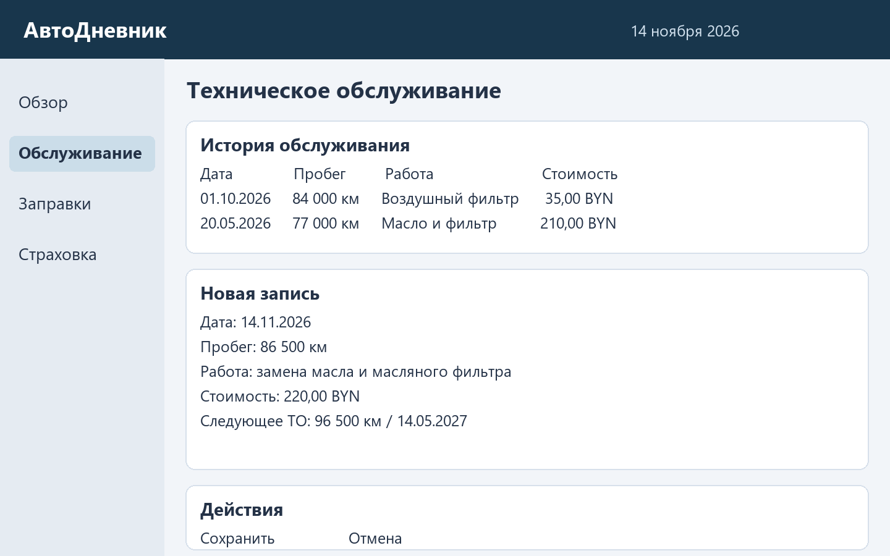
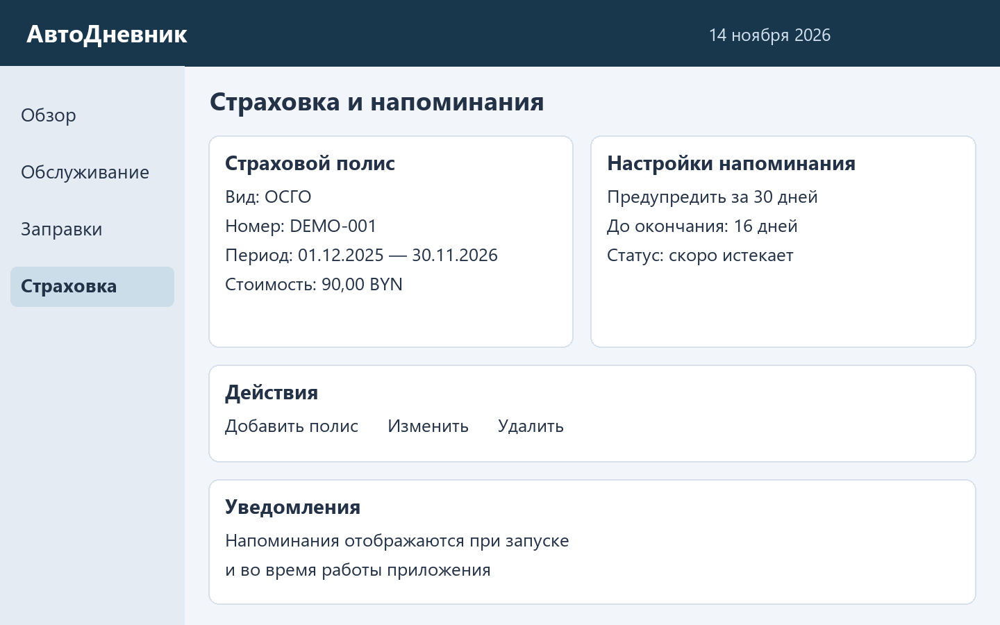

# Спецификация требований к ПО

Для АвтоДневник

Версия 0.1

Подготовил Лакотко Владислав Александрович

Группа 450502 · БГУИР

14 ноября 2026 г.

## Оглавление

- [1. Введение](#introduction)
- [2. Обзор продукта](#product-overview)
- [3. Требования](#requirements)
- [4. Верификация](#verification)
- [5. Приложения](#appendixes)

## История изменений

| Автор | Дата | Изменение | Версия |
|---|---|---|---|
| Лакотко Владислав Александрович | 14.11.2026 | Первоначальная спецификация АвтоДневника | 0.1 |

## 1. Введение

### 1.1 Назначение документа

SRS определяет требования к настольному приложению «Дневник автомобиля (ТО, заправки, страховка)». Документ предназначен для владельца автомобиля, разработчика, тестировщика и преподавателя. Он служит основой для проектирования, реализации и проверки продукта.

### 1.2 Область применения продукта

АвтоДневник объединяет учёт пробега, дат ТО, замен масла и фильтров, историю заправок и сроки страховки. Первая версия рассчитана на одного пользователя на одном компьютере и несколько автомобилей с независимыми историями. Ввод данных ручной. Вне области проекта: GPS, OBD, запись на СТО, покупка полисов, оплата и облачная синхронизация.

Бизнес-цели:

| ID | Цель | Критерий достижения |
| --- | --- | --- |
| BG-01 | Не пропускать обслуживание | Все планы с наступившим сроком видны при запуске приложения; условия по пробегу и дате проверяются независимо. |
| BG-02 | Собрать историю в одном месте | За выбранный период доступны ТО, замены расходников, заправки и полисы конкретного автомобиля. |
| BG-03 | Контролировать расходы | Суммы по категориям за период совпадают с суммами сохранённых записей. |
| BG-04 | Заранее продлевать страховку | Предупреждение появляется за установленное число дней и сохраняется до продления или истечения полиса. |

### 1.3 Определения, акронимы и сокращения

| Термин | Определение |
|---|---|
| ТО | Техническое обслуживание автомобиля |
| SRS | Спецификация требований к ПО |
| MVP | Первая версия с обязательными функциями |
| SysML v2 | Язык системного моделирования |
| BYN | Белорусский рубль |
| План ТО | Работа с датой и/или пробегом выполнения |

### 1.4 Ссылки

1. [Шаблон спецификации](srs-template.md).
2. Методические указания к лабораторной работе № 3 «Разработка и документирование бизнес-требований».
3. [Репозиторий проекта](https://github.com/vi13x/SDLC).
4. [Терминология проекта](../docs/terminology.md).

### 1.5 Обзор документа

Раздел 2 задаёт контекст и ограничения продукта, раздел 3 — требования, раздел 4 — способы их проверки, раздел 5 — структурные модели и мокапы.

## 2. Обзор продукта

### 2.1 Перспектива продукта

АвтоДневник — самостоятельное локальное приложение. Оно заменяет разрозненные заметки и таблицы расходов единой историей автомобиля. Технологии реализации: C++17, Qt Widgets, SQLite и CMake. Сервер и подключение к Интернету не требуются.

### 2.2 Функции продукта

- Карточки автомобилей и обновление пробега.
- История ТО и замен масла и фильтров.
- Планирование обслуживания по дате и пробегу.
- История заправок с объёмом топлива и стоимостью.
- Учёт полисов и сроков действия страховки.
- Напоминания о предстоящих и просроченных событиях.
- Итоги расходов за период и резервное копирование.

### 2.3 Ограничения продукта

Windows 10/11 x64; русский интерфейс; километры, литры и BYN. Пользователь вводит данные вручную. Напоминания доступны только при работающем приложении и пересчитываются при следующем запуске. Автоматическая диагностика и замена одометра в MVP не входят.

### 2.4 Характеристики пользователей

Владелец автомобиля обладает базовыми навыками работы с Windows, вносит сведения о поездках и обслуживании, контролирует расходы и сроки. Отдельные роли администратора и сетевые учётные записи не требуются.

### 2.5 Допущения и зависимости

Пользователь своевременно обновляет пробег; системная дата верна. Регламент обслуживания задаётся по документации автомобиля. Qt обеспечивает интерфейс, SQLite — локальное хранение, ОС — доступ к файлам и текущей дате.

### 2.6 Распределение требований

В MVP входят все функции раздела 3.2. Облачная синхронизация, мобильная версия и интеграция с OBD могут рассматриваться после MVP; обязательств по их реализации в этой версии нет.

## 3. Требования

### 3.1 Внешние интерфейсы

#### 3.1.1 Пользовательские интерфейсы

Главный экран содержит карточку автомобиля, ближайшее обслуживание, страховку и быстрые действия. Разделы обслуживания, заправок и страховки предоставляют историю, формы ввода и действия изменения и удаления. Мокапы приведены в разделе 5.

#### 3.1.2 Аппаратные интерфейсы

Стандартные монитор, клавиатура и мышь. Специальное оборудование не требуется.

#### 3.1.3 Программные интерфейсы

Qt Widgets и Qt SQL с драйвером SQLite; файловый интерфейс ОС для базы и резервных копий. Внешнего API и сетевых интеграций в MVP нет.

### 3.2 Функциональные требования

Все REQ-FUNC-001–REQ-FUNC-010 имеют приоритет Must для первой версии.

| ID | Функция | Требование |
| --- | --- | --- |
| REQ-FUNC-001 | Карточка автомобиля | Создание и изменение марки, модели, года выпуска и текущего пробега; привязка всех записей к выбранному автомобилю. |
| REQ-FUNC-002 | Пробег | Ввод текущего пробега целым неотрицательным числом; проверка согласованности с историей событий. |
| REQ-FUNC-003 | Техническое обслуживание | Добавление, просмотр, изменение и удаление записей ТО: дата, пробег, вид работ, стоимость и примечание. |
| REQ-FUNC-004 | Масло и фильтры | Отдельные виды работ: замена масла, масляного, воздушного, салонного и топливного фильтров; возможность объединить работы в одну запись. |
| REQ-FUNC-005 | План обслуживания | Задание следующей даты и/или пробега обслуживания; отображение остатка времени и километров. |
| REQ-FUNC-006 | Заправки | Добавление, просмотр, изменение и удаление записей с датой, пробегом, видом топлива, объёмом, общей суммой и необязательным названием АЗС. |
| REQ-FUNC-007 | История и расходы | Фильтрация заправок и ТО по периоду; сумма затрат отдельно по ТО, топливу и страховке; итоговый объём топлива за период. |
| REQ-FUNC-008 | Страховка | Хранение вида полиса, номера, страховщика, даты начала и окончания, стоимости; сохранение истории полисов. |
| REQ-FUNC-009 | Напоминания | Показ предстоящего и просроченного ТО и истекающих полисов при запуске, изменении данных и смене даты во время работы. |
| REQ-FUNC-010 | Хранение данных | Сохранение записей локально; восстановление при повторном запуске; резервное копирование и восстановление базы с подтверждением замены. |

Система должна выполнять каждую функцию таблицы с соблюдением следующих правил:

| ID | Правило | Условие |
| --- | --- | --- |
| BR-01 | ТО по двум условиям | Если заданы дата D и пробег M, обслуживание наступает при достижении хотя бы одного условия: today ≥ D ИЛИ currentMileage ≥ M. При задании одного условия проверяется только оно. |
| BR-02 | Границы статусов | «Просрочено» — today > D или пробег > M; «Срок наступил» — равенство одному пределу без просрочки другого. «Скоро» — до срока осталось не более установленного порога, включая границу. |
| BR-03 | Порог предупреждения | По умолчанию для ТО: 14 дней или 500 км; для полиса: 30 дней. Пользователь может изменить пороги на неотрицательные целые числа. Пробег не прогнозируется автоматически. |
| BR-04 | Завершение ТО | Сохранение выполненных работ закрывает соответствующий план только после подтверждения. Следующий срок вводится пользователем; история предыдущих работ сохраняется. |
| BR-05 | Срок полиса | Полис действует включительно по дату окончания. В последний день — «Истекает сегодня»; со следующего дня — «Истёк». Дата начала не может быть позже даты окончания. |
| BR-06 | Проверка данных | Даты должны существовать. Даты выполненных ТО и заправок не позже текущей даты; плановые даты могут быть будущими. Объём топлива > 0; денежные суммы ≥ 0 и не более двух знаков после запятой. |
| BR-07 | Исторические записи | Для событий с известным пробегом значение не меньше пробега более раннего события и не больше более позднего. В один день пробег не убывает в порядке событий. Новое событие с большим пробегом повышает текущий пробег. |
| BR-08 | Коррекция пробега | Обычное обновление не уменьшает текущий пробег. Исправление ошибки выполняется отдельным подтверждённым действием и допускается только при согласованной истории; замена одометра вне первой версии. |
| BR-09 | Единицы и валюта | Пробег — км, топливо — л, дата — ДД.ММ.ГГГГ. В первой версии одна валюта BYN; конвертация валют не выполняется. Денежные значения хранятся в копейках. |
| BR-10 | Область уведомлений | Напоминания работают только при запущенном приложении. При следующем запуске пропущенные сроки пересчитываются. Удаление записи требует подтверждения. |

#### Данные и целостность

Автомобиль: идентификатор, марка, модель, год, текущий пробег. ТО: идентификатор, автомобиль, дата, пробег, список работ, сумма, примечание. План: автомобиль, вид работ, дата и/или пробег, статус выполнения. Заправка: автомобиль, дата, пробег, топливо, литры, сумма, АЗС. Полис: автомобиль, вид, номер, страховщик, начало, окончание, стоимость. Запись не может ссылаться на отсутствующий автомобиль.

Действия удаления автомобиля требуют предупреждения об удалении связанных данных и отдельного подтверждения; удаление выполняется одной транзакцией. Экспорт копии использует согласованный снимок SQLite. Импорт проверяет формат, версию схемы и целостность; перед заменой сохраняется копия текущей базы.

### 3.3 Качество обслуживания

| ID | Качество | Проверяемое требование |
| --- | --- | --- |
| REQ-QUAL-001 | Быстродействие | На Windows 10/11 x64, CPU от 2 ядер, ОЗУ 8 ГБ, SSD, при 10 000 записях: запуск ≤ 3 с; открытие истории, фильтрация и сохранение ≤ 1 с в 95 из 100 повторов. |
| REQ-QUAL-002 | Надёжность | Сохранение операции выполняется транзакционно. При прерывании операции после повторного запуска присутствует либо вся новая запись, либо прежнее состояние; частичной записи нет. |
| REQ-QUAL-003 | Локальность | Все основные действия доступны без Интернета. Данные не передаются внешним сервисам; доступ к файлу ограничивается учётной записью ОС. Отдельное шифрование базы в MVP не входит. |
| REQ-QUAL-004 | Удобство | Русский интерфейс; обязательные поля отмечены; сообщение об ошибке называет поле и способ исправления; отмена формы не меняет сохранённые данные. |
| REQ-QUAL-005 | Восстановление | Восстановленная резервная копия содержит то же число автомобилей, ТО, заправок и полисов и те же значения полей. Повреждённая копия отклоняется без замены рабочей базы. |

### 3.4 Соответствие стандартам

Структура SRS следует учебному шаблону репозитория. Требования имеют уникальные идентификаторы и способы проверки. Структурные модели интерфейса представлены в текстовой нотации SysML v2. Соответствие будущей реализации проверяется отдельно; наличие документа не означает сертификацию продукта.

### 3.5 Проектирование и реализация

#### 3.5.1 Установка

Поставляется настольное приложение для Windows x64 с необходимыми библиотеками Qt и драйвером SQLite. База хранится в каталоге данных пользователя.

#### 3.5.2 Сборка и поставка

Код должен собираться компилятором с поддержкой C++17 через CMake. Документация и модели версионируются в Git; изменения рассматриваются через pull request.

#### 3.5.3 Сопровождаемость

Интерфейс, правила расчёта сроков и доступ к данным должны быть разделены. Правила дат, пробега, денежных сумм и восстановления подлежат автоматизированной проверке.

### 3.6 ИИ/МО

Не применяется. Напоминания и расчёты выполняются по детерминированным правилам раздела 3.2.

## 4. Верификация

Все проверки реализации имеют статус Planned: мокапы демонстрируют компоновку, но не подтверждают работу будущей программы.

Для AC-01–AC-07 метод проверки — Test, статус — Planned. Свидетельства выполнения будут добавлены после реализации и запуска проверок.

| ID | Требования | Действие | Ожидаемый результат |
| --- | --- | --- | --- |
| AC-01 | REQ-FUNC-001, REQ-FUNC-002, REQ-FUNC-010 | Создать автомобиль с пробегом 86 500 км; закрыть и открыть приложение. | Карточка и пробег восстановлены без изменений. |
| AC-02 | REQ-FUNC-003, REQ-FUNC-004, REQ-FUNC-005 | Ввести ТО: 14.11.2026, 86 500 км, масло и фильтр, 220 BYN; назначить 96 500 км / 14.05.2027. | Запись доступна в истории, следующий план отображает оба ограничения. |
| AC-03 | REQ-FUNC-005, REQ-FUNC-009 | Установить дату 14.11.2026, пробег 86 500, план 87 000 / 20.11.2026. | Статус «Скоро»; остатки 500 км и 6 дней. При 87 000 — «Срок наступил», при 87 001 — «Просрочено». |
| AC-04 | REQ-FUNC-006, REQ-FUNC-007 | Добавить заправки 35 л / 91 BYN и 40 л / 104 BYN в ноябре 2026; выбрать ноябрь. | История содержит две записи; итоги 75 л и 195 BYN. |
| AC-05 | REQ-FUNC-008, REQ-FUNC-009 | Полис заканчивается 30.11.2026; проверить даты 14.11, 30.11 и 01.12. | Соответственно: «Скоро истекает», «Истекает сегодня», «Истёк». |
| AC-06 | REQ-FUNC-002, REQ-FUNC-003, REQ-FUNC-006 | Ввести −1 л, 31.11.2026 или исторический пробег выше следующей записи. | Сохранение блокируется; данные в базе не меняются; показана причина. |
| AC-07 | REQ-FUNC-010 | Создать копию; добавить запись; восстановить копию. Затем попробовать повреждённый файл. | При подтверждении восстанавливается состояние копии; повреждённый файл не меняет базу. |

| Бизнес цель | Функции | Проверки |
| --- | --- | --- |
| BG-01 | REQ-FUNC-002–REQ-FUNC-005, REQ-FUNC-009 | AC-02, AC-03, AC-06 |
| BG-02 | REQ-FUNC-001, REQ-FUNC-003, REQ-FUNC-004, REQ-FUNC-006, REQ-FUNC-008, REQ-FUNC-010 | AC-01, AC-02, AC-04, AC-05, AC-07 |
| BG-03 | REQ-FUNC-003, REQ-FUNC-006–REQ-FUNC-008 | AC-02, AC-04 |
| BG-04 | REQ-FUNC-008, REQ-FUNC-009 | AC-05 |

| Требование | Метод | Проверка | Статус |
|---|---|---|---|
| REQ-QUAL-001 | Test | 100 повторов запуска и операций на 10 000 записей; сравнить время с пределами | Planned |
| REQ-QUAL-002 | Test | Прервать сохранение и проверить отсутствие частичной записи | Planned |
| REQ-QUAL-003 | Inspection, Test | Выполнить основные операции без сети, проверить отсутствие сетевых запросов | Planned |
| REQ-QUAL-004 | Inspection, Test | Проверить язык, обязательные поля, ошибки и отмену без сохранения | Planned |
| REQ-QUAL-005 | Test | Сравнить записи после восстановления; отклонить повреждённый файл | Planned |

### Сценарии использования

#### UC-01 Запись выполненного ТО

Предусловие: выбран автомобиль. Пользователь открывает обслуживание, заполняет дату, пробег, работы и сумму, при необходимости задаёт следующий срок. Система проверяет данные. После сохранения запись появляется в истории; закрытие старого плана подтверждается отдельно. При ошибке запись не сохраняется, введённые поля остаются доступными для исправления.

#### UC-02 Добавление заправки

Предусловие: выбран автомобиль. Пользователь вводит дату, пробег, вид топлива, литры и сумму. После проверки система сохраняет запись, обновляет текущий пробег при необходимости и пересчитывает итоги выбранного периода. Отмена закрывает форму без сохранения.

#### UC-03 Проверка напоминаний

При запуске, обновлении пробега, изменении планов/полисов и смене даты приложение пересчитывает статусы. Просроченные события показываются первыми, затем наступившие и предстоящие. Для ТО указываются оба остатка, если заданы оба ограничения. Результат зависит только от сохранённых данных и текущей даты.

#### UC-04 Продление страховки

Пользователь создаёт новый полис с новым периодом. Предыдущий полис остаётся в истории; напоминание для выбранного вида страхования строится по действующему полису. Если имеется следующий полис без разрыва покрытия (начало не позже дня после окончания текущего), предупреждение о продлении текущего полиса снимается. При разрыве указывается период без покрытия.

## 5. Приложения

### Структурные модели компонентов интерфейса (SysML v2)

[Исходник главного экрана](diagrams/dashboard-page.sysml).

[Исходник карточки автомобиля](diagrams/vehicle-page.sysml).

[Подробная модель четырёх экранов](diagrams/autodiary.sysml).

### Визуальные мокапы интерфейса

Мокапы показывают проектируемые экраны с демонстрационными данными.

Требования версии 0.1 подготовлены к согласованию. Замечания заказчика и преподавателя и решения по ним фиксируются в pull request. Согласование ещё не выполнено.
